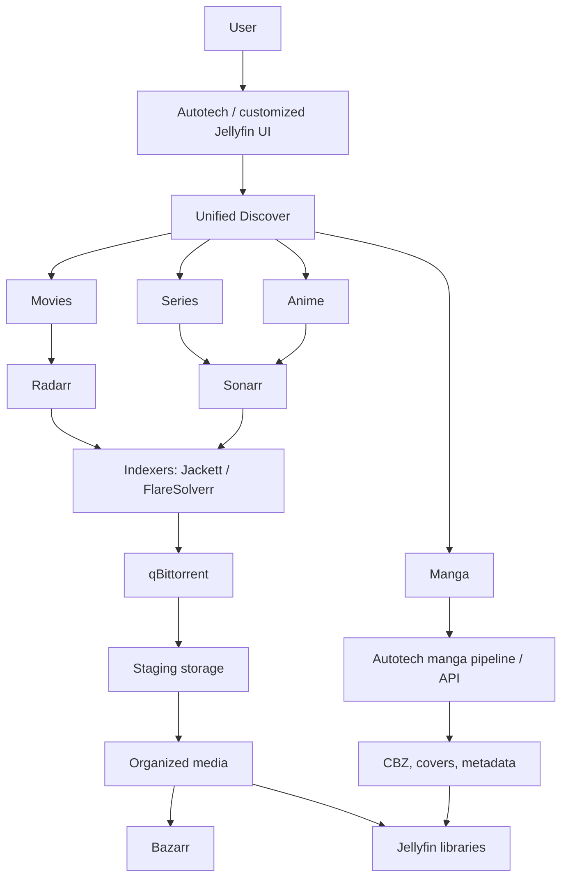

# Autotech Server

**Autotech Server is a cross-platform, self-hosted media automation platform for Windows and Linux.** It discovers, selects, downloads, imports, renames, organizes, enriches, subtitles, and presents movies, series, anime, and manga through Jellyfin while hiding the underlying service complexity from the user.

🌐 **Website:** [autotech.gripe](https://autotech.gripe)

## Current production releases

| Platform | Release |
| --- | --- |
| Windows | **5.0.0** |
| Linux | **5.0.1** |

Both platforms are production targets. This public repository is a sanitized technical portfolio and architecture reference; commercial installers, operational defaults, and private implementation details remain outside it.

## What Autotech manages

| Content | Discovery | Download | Organization | Metadata / covers | Subtitles | Library |
| --- | --- | --- | --- | --- | --- | --- |
| Movies | Discover | Radarr + qBittorrent | Automatic import and naming | Metadata and artwork | Bazarr | Jellyfin |
| Series | Discover | Sonarr + qBittorrent | Import and organization | Metadata and artwork | Bazarr | Jellyfin |
| Anime | Discover | Sonarr + qBittorrent | Dedicated library workflow | Metadata and artwork | Subtitle workflow | Jellyfin |
| Manga | Discover | Autotech Python pipeline | Chapters and CBZ | Covers and metadata | — | Jellyfin |

The engineering challenge is not running each service in isolation. Autotech coordinates different discovery, download, import, storage, metadata, and refresh workflows as one product.

## Architecture

See [the architecture notes](docs/architecture.md) for storage, service boundaries, and public-edition limits.

## Product and engineering capabilities

- Customized Jellyfin experience with Autotech identity, navigation, Discover, Downloads, onboarding, support, libraries, custom covers, and PT-BR / EN internationalization.
- Python backend services, local APIs, provider integrations, discovery, media pipelines, storage management, and update coordination.
- Docker Compose, systemd, Linux services, Windows services, persistence, filesystem layout, networking, and automation.
- Release engineering with platform-specific versioning, manifests, cryptographic signatures, SHA-256 verification, smoke tests, checkpoints, rollback, and updater workflows.
- Product infrastructure for licensing, activation, subscriptions, Stripe integration, support, and separate Windows/Linux installers. Sensitive implementations are intentionally not published here.

## Custom manga platform

The manga subsystem is a first-party Python workflow rather than a thin service wrapper. Its public architecture covers provider abstraction, search and discovery, title resolution, chapter handling, multi-source retrieval, normalization, CBZ packaging, cover and metadata generation, periodic updates, storage, Jellyfin refresh, and a local API. Exact provider behavior and deployment secrets are kept out of this repository.

## Public repository and security

This repository contains documentation, examples, and sanitized assets—not commercial executables, release archives, production databases, customer or license data, Stripe secrets, API keys, tokens, private signing keys, cookies, logs, backups, or real `.env` files. See [the security review](docs/security-review.md).

## Project status

The public edition is a portfolio and architectural reference. Production builds are derived from private, platform-specific sources and are not published here.

## Author

Developed by **Lucas Patrocínio**, Electronic Engineering student at the Federal University of Santa Catarina (UFSC).

## License

The sanitized examples and documentation are available under the [MIT License](LICENSE). Third-party services and assets retain their respective licenses.
