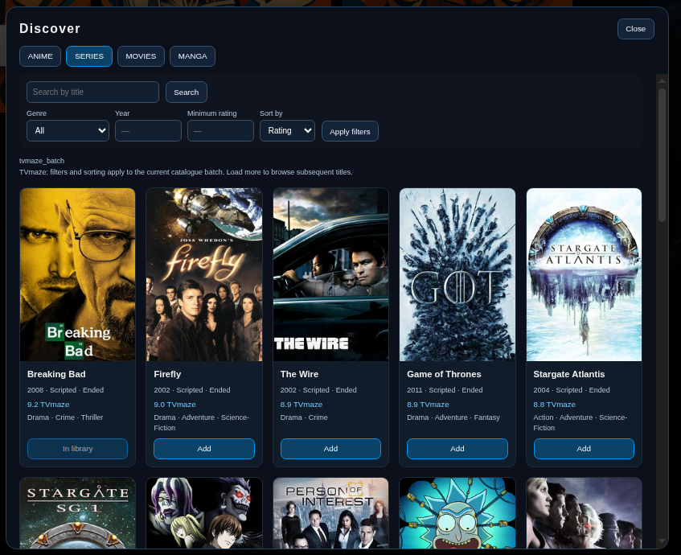
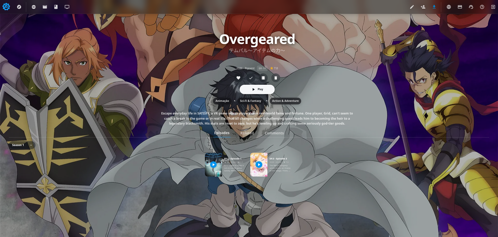
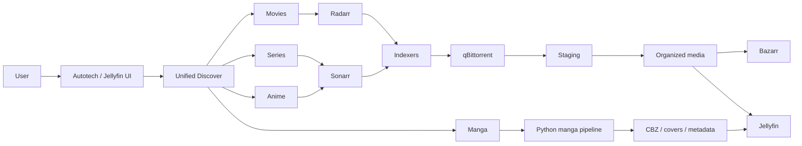

# Autotech Server

### One product. Every library. Any platform.

A cross-platform, self-hosted media automation platform that turns discovery, downloads, organization, metadata, subtitles, and Jellyfin into one coherent user experience.

🌐 **Product:** [api.autotech.gripe](https://api.autotech.gripe)

---

## About

Autotech Server is a production-oriented platform for managing **movies, series, anime, and manga** on Windows and Linux.

Instead of exposing users to a collection of disconnected services, Autotech provides a unified experience for discovering content, coordinating downloads, importing and organizing files, generating metadata and covers, managing subtitles, and keeping Jellyfin libraries up to date.

The project began as a media-server deployment and evolved into a cross-platform product with custom UX, Python services, platform installers, update infrastructure, and release validation.

## Preview

  
  
  

## What makes the project interesting

The challenge is not running Radarr, Sonarr, or qBittorrent independently. The challenge is coordinating their APIs, states, filesystems, permissions, failure modes, and user workflows as one reliable product.

Autotech connects:

- a custom user experience built on top of Jellyfin;
- a unified discovery layer for different kinds of media;
- multiple download and indexer integrations;
- automated import, naming, storage, metadata, and subtitle workflows;
- Windows and Linux installation and service layers;
- updater, manifest, smoke-test, checkpoint, and rollback concerns.

## Main capabilities

### Unified content management

| Content | Discovery | Download | Organization | Metadata / artwork | Library |
| --- | --- | --- | --- | --- | --- |
| Movies | Autotech Discover | Radarr + qBittorrent | Import, rename, organize | Metadata and covers | Jellyfin |
| Series | Autotech Discover | Sonarr + qBittorrent | Import, rename, organize | Metadata and covers | Jellyfin |
| Anime | Autotech Discover | Sonarr + qBittorrent | Dedicated library workflow | Metadata and covers | Jellyfin |
| Manga | Autotech Discover | Custom Python pipeline | Chapters and CBZ | Covers and metadata | Jellyfin |

### Customized Jellyfin experience

- Autotech visual identity and branded libraries.
- Custom navigation, Discover, Downloads, onboarding, and support flows.
- Custom covers and library presentation for movies, series, anime, and manga.
- Portuguese (Brazil) and English internationalization.
- Media detail and browsing experiences adapted to the product workflow.

### Custom manga platform

The manga subsystem is a first-party Python workflow rather than a thin service wrapper. It includes:

- provider abstraction and multi-source retrieval;
- search, discovery, and title resolution;
- chapter handling and normalization;
- CBZ packaging;
- cover and metadata generation;
- periodic updates and storage management;
- Jellyfin refresh integration;
- a local management API.

### Automated media lifecycle

Autotech coordinates the full path from discovery to library:

## Technology and engineering scope

### Backend

- Python services and local APIs.
- Provider integrations, discovery, title resolution, and media pipelines.
- Storage management, filesystem boundaries, metadata, subtitles, and library refresh.

### Infrastructure

- Windows and Linux installers and service integration.
- Docker Compose, systemd, persistence, permissions, networking, and automation.
- Jellyfin, Sonarr, Radarr, qBittorrent, Jackett, Bazarr, and FlareSolverr integration.

### Product engineering

- Licensing, activation, subscriptions, support, and platform-specific update flows.
- User-oriented abstractions over complex technical services.
- Clear separation between staging storage, organized libraries, and runtime state.

### Release engineering

- Independent platform versioning and release manifests.
- Cryptographic signatures and SHA-256 verification.
- Smoke tests, checkpoints, rollback procedures, and updater workflows.

## Production status

| Platform | Current production release |
| --- | ---: |
| Windows | **5.0.0** |
| Linux | **5.0.1** |

Windows and Linux are production targets. This public repository documents the architecture and presents sanitized examples; it is not the commercial installer repository.

## Repository

This public repository is a portfolio and architecture presentation. It contains documentation, examples, and sanitized assets while intentionally excluding commercial installers, release archives, production databases, customer or license data, Stripe secrets, API keys, tokens, private signing keys, cookies, logs, backups, and real environment files.

See also:

- [Architecture](docs/architecture.md)
- [Capabilities](docs/capabilities.md)
- [Security review](docs/security-review.md)

## Current status and roadmap

The production platform is maintained in private, platform-specific development sources. The public edition evolves as a technical reference and portfolio presentation; sensitive implementation details remain private by design.

## Author

Developed by **Lucas Patrocínio**, Electronic Engineering student at the Federal University of Santa Catarina (UFSC).

## License

Sanitized examples and documentation are available under the [MIT License](LICENSE). Third-party services and assets retain their respective licenses.

  Autotech Server — media automation designed as a product.

