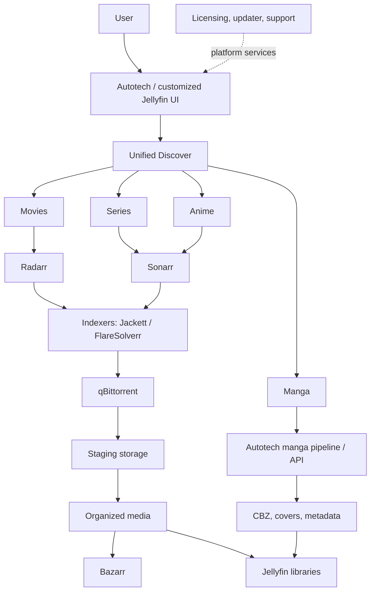

# Autotech Server

**A cross-platform, self-hosted media automation platform for Windows and Linux.**

Autotech turns a collection of specialized media services into one cohesive product. Users can discover, select, download, import, rename, organize, enrich, subtitle, and browse movies, series, anime, and manga through a customized Jellyfin experience.

🌐 **Product:** [api.autotech.gripe](https://api.autotech.gripe)

## Why this project matters

Autotech is a practical example of product engineering across the full stack:

- a user-facing experience built on top of Jellyfin;
- Python APIs and media-processing workflows;
- integrations with multiple third-party services;
- Windows and Linux installation and service layers;
- storage, permissions, update, and recovery concerns;
- release engineering for a real cross-platform product.

The difficult part is not deploying Radarr, Sonarr, or qBittorrent separately. The difficult part is coordinating their different APIs, states, filesystems, failure modes, and user workflows as one reliable system.

## Production status

| Platform | Current production release |
| --- | ---: |
| Windows | **5.0.0** |
| Linux | **5.0.1** |

Windows and Linux are production targets. This repository is the sanitized public portfolio edition; commercial installers, customer data, operational defaults, and sensitive implementation details remain private.

## Supported content workflows

| Content | Discovery | Download | Organization | Metadata and artwork | Subtitles | Library |
| --- | --- | --- | --- | --- | --- | --- |
| Movies | Autotech Discover | Radarr + qBittorrent | Import, rename, organize | Metadata and covers | Bazarr | Jellyfin |
| Series | Autotech Discover | Sonarr + qBittorrent | Import, rename, organize | Metadata and covers | Bazarr | Jellyfin |
| Anime | Autotech Discover | Sonarr + qBittorrent | Dedicated library workflow | Metadata and covers | Subtitle workflow | Jellyfin |
| Manga | Autotech Discover | Custom Python pipeline | Chapters and CBZ | Covers and metadata | — | Jellyfin |

Autotech coordinates discovery, download, import, storage, metadata, subtitles, and library refresh as a unified lifecycle.

## Architecture

See [the architecture notes](docs/architecture.md) and [the capabilities overview](docs/capabilities.md).

## Engineering scope

### Product and user experience

- Deep Jellyfin customization with Autotech visual identity.
- Custom navigation, Discover, Downloads, onboarding, support, and library experiences.
- Custom artwork and covers with PT-BR / EN internationalization.

### Backend and integrations

- Python services and local APIs.
- Provider abstraction, discovery, title resolution, download orchestration, import, and media processing.
- Storage management, filesystem boundaries, metadata, subtitles, and Jellyfin refresh workflows.

### Platform and infrastructure

- Windows and Linux installers and service integration.
- Docker Compose, systemd, persistence, networking, permissions, and update coordination.
- Clear separation between download staging and organized media libraries.

### Release engineering

- Independent platform versioning and release manifests.
- Cryptographic signatures and SHA-256 verification.
- Smoke tests, checkpoints, rollback procedures, and updater workflows.

### Product infrastructure

The wider private product includes licensing, activation, subscriptions, Stripe integration, support, and platform-specific release infrastructure. This public repository documents the architecture without exposing sensitive implementations.

## Custom manga platform

The manga subsystem is a first-party Python workflow, not just a wrapper around another service. It includes provider abstraction, search and discovery, title resolution, chapter handling, multi-source retrieval, normalization, CBZ packaging, cover and metadata generation, periodic updates, storage, Jellyfin refresh, and a local API.

## Repository boundaries and security

This public edition contains documentation, examples, and sanitized assets. It intentionally excludes commercial executables and installers, release archives, production databases, customer or license data, Stripe secrets, API keys, tokens, private signing keys, cookies, logs, backups, and real environment files.

## Project status

Production source is maintained in private platform-specific repositories. This repository is designed for architectural review, technical discussion, and portfolio evaluation—not as a downloadable production installer.

## Author

Developed by **Lucas Patrocínio**, Electronic Engineering student at the Federal University of Santa Catarina (UFSC).

## License

Sanitized examples and documentation are available under the [MIT License](LICENSE). Third-party services and assets retain their respective licenses.
