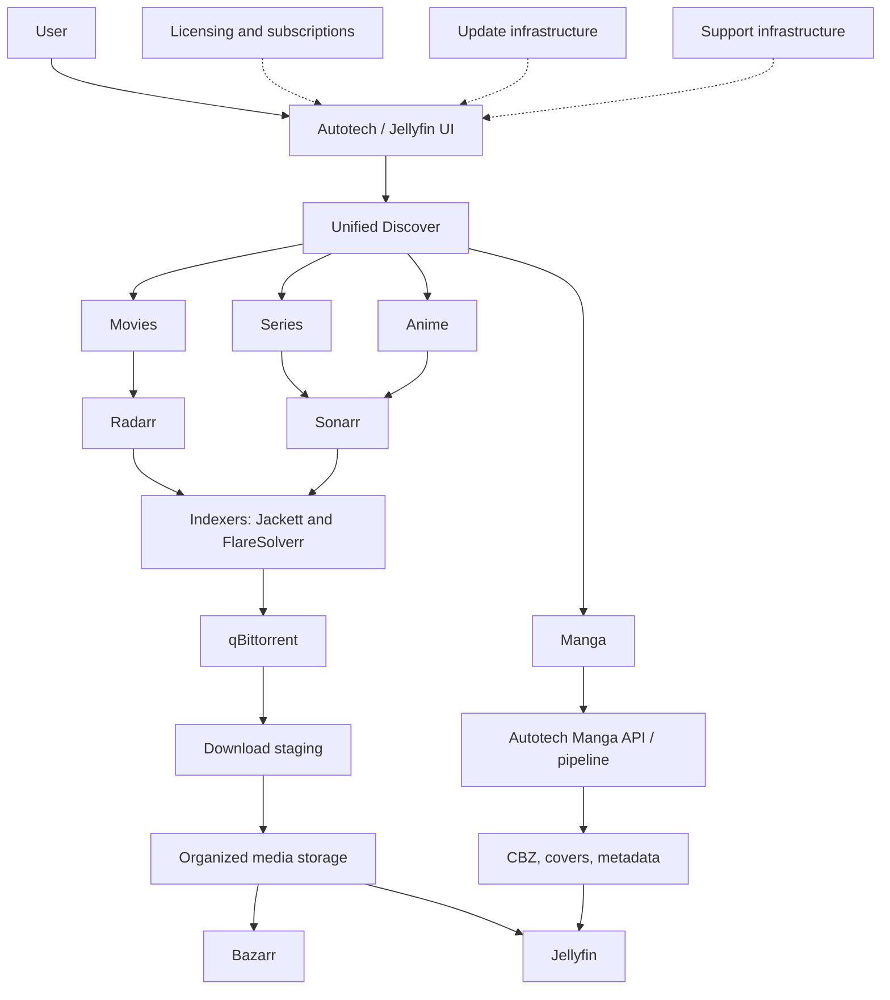

# Autotech Server architecture

Autotech is a production cross-platform platform: Windows 5.0.0 and Linux 5.0.1. The public repository documents the interfaces and responsibilities without exposing the commercial installer or operational secrets.

## Conceptual flow

## Components

- **Autotech layer:** unified discovery, onboarding, local APIs, storage orchestration, product UI extensions, licensing, updater, and support integration.
- **Discover:** one user-facing entry point that routes movies, series, anime, and manga to the appropriate workflow.
- **Servarr and download services:** Radarr handles movies; Sonarr handles series and anime; Jackett and FlareSolverr support indexer integration; qBittorrent performs downloads.
- **Manga subsystem:** a custom Python pipeline and local Manga API for providers, discovery, chapter retrieval, normalization, CBZ creation, covers, metadata, and Jellyfin refresh.
- **Library services:** organized media is processed by Bazarr where applicable and indexed by Jellyfin.

## Storage and lifecycle

Downloads use staging storage, while imported content is placed in organized libraries for Jellyfin. The separation supports predictable imports, filesystem permissions, cleanup boundaries, and recovery checkpoints. Exact production paths are deployment-specific and are not part of this public edition.

## Platform targets

Windows and Linux are supported production targets. The platform-specific installers and service integration are maintained privately; this repository exposes the architecture, examples, and sanitized documentation.

## Operational boundaries

Licensing, activation, subscriptions, update manifests, signatures, SHA-256 verification, smoke tests, rollback, and support are Autotech platform concerns. Their existence is documented here, but credentials, signing material, customer data, production databases, and commercial installer code are excluded.
